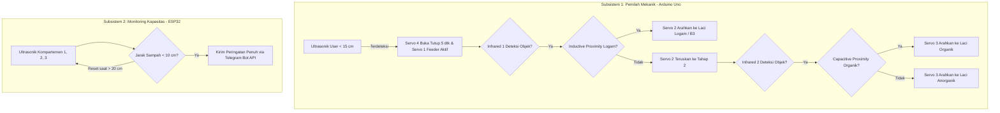

# SIPILAH: Automatic Waste Sorting System Using Sensors and Microcontrollers Based on IoT

**SIPILAH** adalah sistem tempat sampah pintar berbasis mikrokontroler ganda (**Arduino Uno** dan **ESP32**) yang dirancang untuk memisahkan sampah rumah tangga secara otomatis ke dalam tiga kategori (**Logam/B3**, **Anorganik**, dan **Organik**) serta mengirimkan notifikasi kapasitas penuh secara *real-time* melalui **Telegram Bot**.

> **Publikasi Ilmiah:** *SIPILAH: Automatic Waste Sorting System Using Sensors and Microcontrollers Based on IoT* — Dipresentasikan pada **INCITEST '25** (*International Conference on Informatics, Engineering, Science, and Technology*).  
> **DOI:** [10.35453/NEDJR-INCITEST008-2025](https://doi.org/10.35453/NEDJR-INCITEST008-2025)

---

## Ringkasan & Hasil Evaluasi Pengujian

* **Lokasi Implementasi:** Kelurahan Cipadung Kidul, Kecamatan Panyileukan, Kota Bandung.
* **Dimensi Prototipe:** Konstruksi kayu dan multipleks berukuran **107 cm (P) × 61 cm (L) × 130 cm (T)** dengan tiga laci kompartemen terpisah.
* **Akurasi Pemilahan:** Mencapai tingkat keberhasilan **90% dari 20 kali pengujian** acak pada berbagai kategori sampah:
  * **Logam / B3:** Kaleng minuman, pipa besi, seng.
  * **Organik:** Daun, kulit pisang, buah mengkudu, tomat, mentimun, ranting.
  * **Anorganik:** Plastik hitam/abu-abu, kertas, koran, kardus, karton, uang kertas, mainan plastik.
* **Respons Otomatisasi:** Tutup tong terbuka otomatis saat pengguna terdeteksi pada jarak `< 15 cm` (menutup kembali setelah 5 detik), dan notifikasi Telegram terkirim otomatis saat tinggi tumpukan sampah mencapai jarak `< 10 cm` dari sensor kompartemen.
* **Keterbatasan Sistem (*Known Limitations*):** Berdasarkan hasil uji karakterisasi sensor, pemilahan kurang optimal pada plastik/gelas bening transparan (lemahnya pantulan gelombang sensor *Infrared Proximity*) serta objek logam berukuran sangat kecil seperti baut.

---

## Dokumentasi Prototipe & Skema Rangkaian

### Tampilan Fisik Alat
| Tampak Luar Prototipe | Mekanisme Pemilah Internal |
| :---: | :---: |
|  |  |

### Skema Rangkaian Elektronik


---

## Arsitektur & Alur Kerja Sistem

Sistem memisahkan kendali aktuator mekanik dan komunikasi jaringan ke dua mikrokontroler berbeda agar proses pemilahan tetap responsif tanpa terhambat latensi WiFi:



---

## Daftar Komponen (*Bill of Materials*) & Konfigurasi Pin

### Spesifikasi Perangkat Keras
* **Mikrokontroler:** 1× Arduino Uno R3, 1× ESP32 (ESP32-WROVER)
* **Sensor Pemilah:** 2× Infrared Proximity Sensor, 1× Inductive Proximity Sensor, 1× Capacitive Proximity Sensor
* **Sensor Jarak & Volume:** 4× Ultrasonik HC-SR04 (1 deteksi pengguna, 3 deteksi kapasitas laci)
* **Aktuator:** 4× Motor Servo

### 1. Pemetaan Pin Arduino Uno (`firmware/caps_uno/caps_uno.ino`)
| Komponen | Pin Arduino Uno | Fungsi |
| :--- | :---: | :--- |
| Servo 1 (Feeder / Pengumpan) | `D2` | Mengatur aliran masuk objek ke jalur pemilah |
| Servo 2 (Pemilah Tahap 1) | `D3` | Mengarahkan sampah Logam vs Non-Logam |
| Servo 3 (Pemilah Tahap 2) | `D4` | Mengarahkan sampah Anorganik vs Organik |
| Servo 4 (Tutup Tong) | `D5` | Membuka dan menutup tutup utama secara otomatis |
| Sensor Infrared 1 | `D6` | Deteksi objek masuk tahap 1 |
| Sensor Infrared 2 | `D7` | Deteksi objek masuk tahap 2 |
| Sensor Inductive Proximity | `D8` | Deteksi material logam |
| Sensor Capacitive Proximity | `D9` | Deteksi material organik / anorganik |
| Ultrasonik HC-SR04 (User) | `D10` (Trig), `D11` (Echo) | Deteksi jarak pengguna di depan tong (`< 15 cm`) |

### 2. Pemetaan Pin ESP32 (`firmware/caps_esp/caps_esp.ino`)
| Komponen | Pin ESP32 | Fungsi |
| :--- | :---: | :--- |
| Ultrasonik Kompartemen 1 | `GPIO 12` (Trig), `GPIO 14` (Echo) | Monitoring kapasitas kompartemen Logam / B3 |
| Ultrasonik Kompartemen 2 | `GPIO 27` (Trig), `GPIO 26` (Echo) | Monitoring kapasitas kompartemen Anorganik |
| Ultrasonik Kompartemen 3 | `GPIO 25` (Trig), `GPIO 33` (Echo) | Monitoring kapasitas kompartemen Organik |

---

## Struktur Repository

```text
sipilah-smart-waste-system/
├── firmware/
│   ├── caps_uno/
│   │   └── caps_uno.ino          # Firmware kontrol servo & sensor pemilah (Arduino Uno)
│   └── caps_esp/
│       ├── caps_esp.ino          # Firmware monitoring ultrasonik & bot Telegram (ESP32)
│       └── secrets.example.h     # Template konfigurasi WiFi & token Telegram
├── docs/
│   ├── prototype1.jpg            # Foto tampak luar prototipe SIPILAH
│   ├── prototype2.jpg            # Foto mekanisme pemilah internal
│   └── schematic.png             # Skema rangkaian elektronik
├── .gitignore
└── README.md
```

---

## Panduan Replikasi Hardware (Flashing Firmware)

### Prasyarat Lingkungan Pengembangan
* **Arduino IDE** (versi 1.8.x atau 2.x)
* **Board Package:** *Arduino AVR Boards* (untuk Uno) dan *esp32 by Espressif Systems* (untuk ESP32)
* **Library:** `Servo.h` (bawaan Arduino IDE), `WiFi.h` & `HTTPClient.h` (bawaan paket board ESP32)

### Langkah Unggah Firmware
1. **Flashing Arduino Uno:**
   * Hubungkan board **Arduino Uno** ke PC menggunakan kabel USB.
   * Buka `firmware/caps_uno/caps_uno.ino` di Arduino IDE, pilih board **Arduino Uno** beserta port COM yang aktif, lalu klik **Upload (`→`)**.
2. **Flashing ESP32:**
   * Masuk ke folder `firmware/caps_esp/`, duplikat file `secrets.example.h`, dan ubah namanya menjadi `secrets.h`.
   * Isi kredensial WiFi (`ssid`, `password`) serta `BOT_TOKEN` dan `CHAT_ID` Telegram Anda di dalam `secrets.h`.
   * Hubungkan board **ESP32** ke PC via USB, buka `caps_esp.ino` di Arduino IDE, pilih board yang sesuai (misalnya **ESP32 Dev Module** / **ESP32 Wrover Module**) dan port COM-nya, lalu klik **Upload (`→`)**.

---

## Sitasi (*Citation*)

Jika proyek atau referensi ini membantu penelitian Anda, silakan sitasi publikasi berikut:

```bibtex
@inproceedings{sipilah_incitest2025,
  author    = {Nama Penulis1 and Nama Penulis2},
  title     = {SIPILAH: Automatic Waste Sorting System Using Sensors and Microcontrollers Based on IoT},
  booktitle = {International Conference on Informatics, Engineering, Science, and Technology (INCITEST)},
  year      = {2025},
  doi       = {10.35453/NEDJR-INCITEST008-2025}
}
```