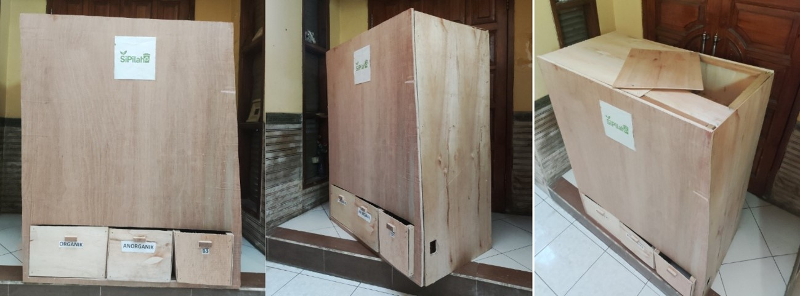
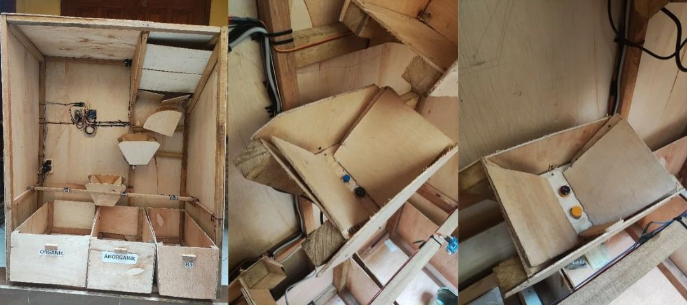
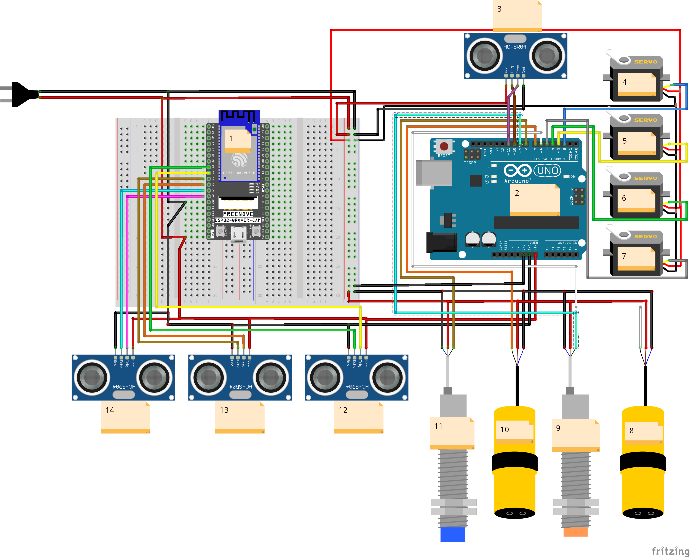

# SIPILAH: Automatic Waste Sorting System Using Sensors and Microcontrollers Based on IoT

**SIPILAH** adalah sistem tempat sampah pintar berbasis mikrokontroler ganda (**Arduino Uno** dan **ESP32**) yang dirancang untuk memisahkan sampah rumah tangga secara otomatis ke dalam tiga kategori (**Logam/B3**, **Anorganik**, dan **Organik**) serta mengirimkan notifikasi kapasitas penuh secara *real-time* melalui **Telegram Bot**.

> **Publikasi Ilmiah:** *SIPILAH: Automatic Waste Sorting System Using Sensors and Microcontrollers Based on IoT* — Dipresentasikan pada konferensi internasional **INCITEST '25** (*International Conference on Informatics, Engineering, Science, and Technology*).

---

## Ringkasan & Hasil Pengujian

* **Lokasi Implementasi:** Kelurahan Cipadung Kidul, Kecamatan Panyileukan, Kota Bandung.
* **Dimensi Prototipe:** Konstruksi kayu dan multipleks berukuran **107 cm (P) × 61 cm (L) × 130 cm (T)** dengan tiga laci kompartemen terpisah.
* **Akurasi Pemilahan:** Mencapai tingkat keberhasilan **90% dari 20 kali pengujian** berbagai jenis sampah (kaleng, pipa besi, seng, plastik, kertas, kardus, daun, kulit pisang, dan buah/sayur).
* **Respons Sensor:** Tutup tong terbuka otomatis saat pengguna terdeteksi pada jarak `≤ 15 cm`, dan notifikasi Telegram terkirim otomatis saat tinggi tumpukan sampah mencapai jarak `< 10 cm` dari sensor kompartemen.

---

## Dokumentasi Prototipe & Skema Rangkaian

### Tampilan Fisik Alat
| Tampak Luar Prototipe | Mekanisme Pemilah Internal |
| :---: | :---: |
|  |  |

### Skema Rangkaian Elektronik


---

## Arsitektur & Alur Kerja Sistem

Sistem memisahkan kendali aktuator mekanik dan komunikasi jaringan ke dua mikrokontroler berbeda agar proses pemilahan tetap responsif tanpa terhambat latensi WiFi:

1. **Subsistem Pemilah Mekanik (`Arduino Uno` — `caps_uno.ino`)**
   * **Akses Tanpa Sentuh:** Sensor ultrasonik mendeteksi kehadiran pengguna (`< 15 cm`) dan menggerakkan servo tutup utama selama 5 detik.
   * **Pemilahan Tahap 1 (Logam vs Non-Logam):** Sensor *Infrared 1* mendeteksi objek masuk, lalu sensor **Inductive Proximity** mengidentifikasi material logam untuk diarahkan ke kompartemen logam/B3. Material non-logam diteruskan ke tahap berikutnya.
   * **Pemilahan Tahap 2 (Organik vs Anorganik):** Sensor *Infrared 2* memicu pembacaan sensor **Capacitive Proximity** untuk membedakan sampah organik (berkadar air/konstanta dielektrik tinggi) dan anorganik kering sebelum dijatuhkan ke laci masing-masing.

2. **Subsistem Monitoring Kapasitas IoT (`ESP32` — `caps_esp.ino`)**
   * Tiga sensor ultrasonik HC-SR04 memantau ketinggian isi di kompartemen Organik, Anorganik, dan Logam/B3 secara independen.
   * Ketika salah satu kompartemen mencapai batas penuh (`< 10 cm`), ESP32 mengirimkan peringatan otomatis ke **Telegram** via HTTP GET API dan mereset status setelah laci dikosongkan (`> 20 cm`).

---

## Konfigurasi Pin Hardware

### 1. Arduino Uno (Kontrol Sensor Pemilah & Servo)
| Komponen | Pin Arduino Uno | Fungsi |
| :--- | :---: | :--- |
| Servo 1 (Feeder / Pengumpan) | `D2` | Mengatur aliran masuk objek ke jalur pemilah |
| Servo 2 (Pemilah Tahap 1) | `D3` | Mengarahkan sampah Logam vs Non-Logam |
| Servo 3 (Pemilah Tahap 2) | `D4` | Mengarahkan sampah Anorganik vs Organik |
| Servo 4 (Tutup Tong) | `D5` | Membuka dan menutup tutup utama secara otomatis |
| Sensor Infrared 1 | `D6` | Deteksi objek masuk tahap 1 |
| Sensor Infrared 2 | `D7` | Deteksi objek masuk tahap 2 |
| Sensor Inductive Proximity | `D8` | Deteksi material logam |
| Sensor Capacitive Proximity | `D9` | Deteksi material organik / anorganik |
| Ultrasonik HC-SR04 (User) | `D10` (Trig), `D11` (Echo) | Deteksi jarak pengguna di depan tong |

### 2. ESP32 (Monitoring Kapasitas & Notifikasi Telegram)
| Komponen | Pin ESP32 | Fungsi |
| :--- | :---: | :--- |
| Ultrasonik Kompartemen 1 | `GPIO 12` (Trig), `GPIO 14` (Echo) | Monitoring kapasitas kompartemen Logam / B3 |
| Ultrasonik Kompartemen 2 | `GPIO 27` (Trig), `GPIO 26` (Echo) | Monitoring kapasitas kompartemen Anorganik |
| Ultrasonik Kompartemen 3 | `GPIO 25` (Trig), `GPIO 33` (Echo) | Monitoring kapasitas kompartemen Organik |

---

## Struktur Repository

```text
sipilah-smart-waste-system/
├── firmware/
│   ├── caps_uno/
│   │   └── caps_uno.ino          # Firmware kontrol servo & sensor pemilah (Arduino Uno)
│   └── caps_esp/
│       ├── caps_esp.ino          # Firmware monitoring ultrasonik & bot Telegram (ESP32)
│       └── secrets.example.h     # Template konfigurasi WiFi & token Telegram
├── docs/
│   ├── prototype1.jpg            # Foto tampak luar prototipe SIPILAH
│   ├── prototype2.jpg            # Foto mekanisme pemilah internal
│   └── schematic.png             # Skema rangkaian elektronik
├── .gitignore
└── README.md
```

---

## Panduan Replikasi Hardware (Flashing Firmware)

Bagi pengembang atau peneliti yang ingin mereplikasi sistem ini ke perangkat keras:

1. **Flashing Arduino Uno:**
   * Hubungkan board fisik **Arduino Uno** ke PC menggunakan kabel USB.
   * Buka `firmware/caps_uno/caps_uno.ino` di Arduino IDE, pilih board **Arduino Uno** beserta port COM yang aktif, lalu klik **Upload (`→`)**.
2. **Flashing ESP32:**
   * Masuk ke folder `firmware/caps_esp/`, duplikat file `secrets.example.h`, dan ubah namanya menjadi `secrets.h`.
   * Isi kredensial WiFi (`ssid`, `password`) serta `BOT_TOKEN` dan `CHAT_ID` Telegram Anda di dalam `secrets.h`.
   * Hubungkan board fisik **ESP32** ke PC via USB, buka `caps_esp.ino` di Arduino IDE, pilih board **ESP32 Dev Module** dan port COM-nya, lalu klik **Upload (`→`)**.